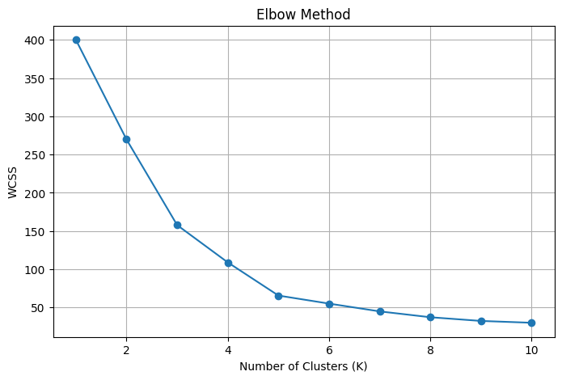
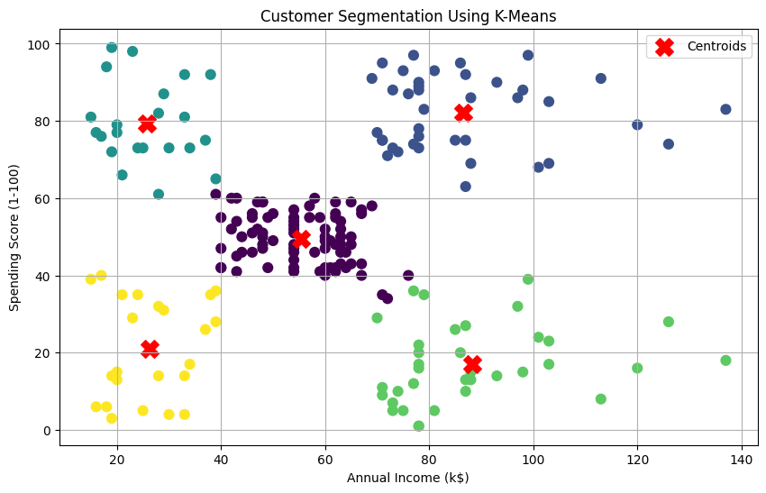

Customer Segmentation Using K-Means Clustering

1. Project Overview

This project implements the K-Means Clustering Algorithm using Python to perform customer segmentation.

The main objective is to group customers based on their annual income and spending score. This helps businesses understand customer behaviour and identify different customer groups for better marketing strategies.

2. Dataset

Dataset: Mall Customers Dataset

Source: GitHub

The dataset contains 200 customer records with the following attributes:

- Customer ID
- Gender
- Age
- Annual Income (k$)
- Spending Score (1-100)

For clustering, two important features were selected:

- Annual Income (k$)
- Spending Score (1-100)

3. Technologies Used

- Python
- Google Colab
- Pandas
- NumPy
- Matplotlib
- Seaborn
- Scikit-learn

4. Implementation Steps

1. Import the required Python libraries.
2. Load the Mall Customers dataset.
3. Explore and understand the dataset.
4. Select Annual Income and Spending Score as features.
5. Apply StandardScaler for feature scaling.
6. Use the Elbow Method to determine the optimal number of clusters.
7. Evaluate different cluster values using the Silhouette Score.
8. Apply the K-Means Clustering algorithm.
9. Visualize the customer clusters and centroids.
10. Analyze the final clusters.

5. Optimization Techniques

The following techniques were used to improve the clustering process:

- Feature Scaling: StandardScaler was applied to bring both features to a comparable scale.
- Elbow Method: Used to analyze Within-Cluster Sum of Squares (WCSS) and identify a suitable number of clusters.
- Silhouette Score: Used to compare clustering quality for different values of K.
- Optimal K Selection: The final model uses K = 5 based on the highest observed Silhouette Score.

6. Model Evaluation Results

| Parameter | Result |
|---|---|
| Algorithm | K-Means |
| Number of Clusters | 5 |
| Inertia (WCSS) | 65.57 |
| Silhouette Score | 0.555 |
| Total Customers | 200 |

### Silhouette Score Comparison

| K | Silhouette Score |
|---|---|
| 2 | 0.321 |
| 3 | 0.467 |
| 5 | 0.555 |
| 6 | 0.540 |
| 7 | 0.528 |
| 8 | 0.455 |
| 9 | 0.457 |
| 10 | 0.443 |

Result: K = 5 achieved the highest observed Silhouette Score of 0.555 among the tested values.

### Customer Segmentation Analysis

The final K-Means model divided 200 customers into five clusters.

| Cluster | Number of Customers |
|---|---|
| 0 | 81 |
| 1 | 39 |
| 2 | 22 |
| 3 | 35 |
| 4 | 23 |
| Total | 200 |

These clusters represent different customer spending and income patterns.

8. Visualizations

Elbow Method

### Elbow Method

### Customer Segmentation

Customer Segmentation Using K-Means

9. Project Files

- "Customer_Segmentation_KMeans.ipynb" – Complete Python implementation.
- "Customer_Segmentation_Results.csv" – Clustering results.
- "elbow_method.png" – Elbow Method graph.
- "customer_cluster.png" – Customer cluster visualization.

10. Conclusion

The K-Means Clustering algorithm successfully grouped 200 customers into five clusters based on annual income and spending score.

The final Silhouette Score of 0.555 indicates a reasonable clustering structure. The project demonstrates how unsupervised machine learning can be used to understand customer behaviour and support business decision-making.

## Authors

1. Zaid Akbar

2. Faiz Ahmed

## Subject
Machine Learning Theory

## Project Title
Customer Segmentation Using K-Means Clustering
